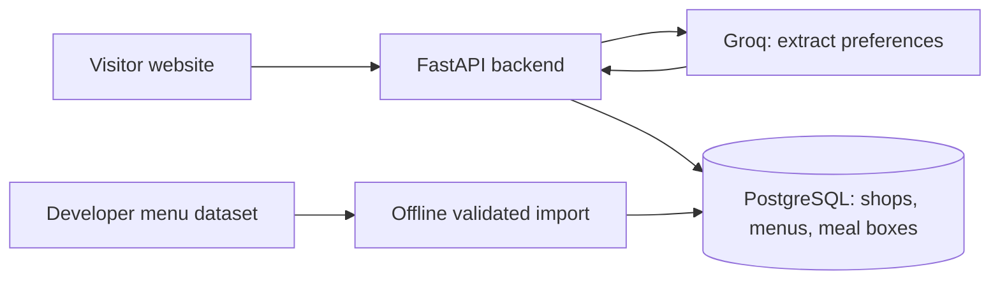

# AnimoMeals · AI Food Budget Recommender

AnimoMeals helps students choose meals from recorded local shop menus based on their budget and food preferences. A visitor can describe what they want, compare meal combinations, and save favorite combinations as **My Meal Boxes**. No visitor account or administrator dashboard is required.

## Revised scope — November 4, 2026

The former administrator app has been retired. Shop and menu editing, administrator login, and photo-upload endpoints are removed. The developer maintains a small curated menu dataset through an offline import command. This avoids daily vendor checks; it does not eliminate the need to occasionally correct recorded prices.

We list regular menu offerings, not live stock. Prices and availability must be confirmed at the shop. We do not claim food quality, nutrition, distance, current stock, or complete ingredient/allergen knowledge. Unknown spice details are excluded when a visitor requests non-spicy meals. The published catalog currently contains 9 shops and 28 items. The developer updates the recorded menus when reliable information is supplied.

| Selected shop | Location supplied for this project |
| --- | --- |
| Maria Rosa | Location to be confirmed |
| Pritong Manok | USLS Stingers |
| Nene’s | In front of Gate 5 |
| Crazy Crunch | Ground floor, MM Building |
| Lola Barbz | The Agora |
| Jollibee - Bacolod La Salle | La Salle Avenue, Bacolod |
| McDonald's - North Drive La Salle | North Drive La Salle, Bacolod |
| Potato Corner - USLS Agora | Inside Lasalle, AGORA |
| BAMSOYS | Location to be confirmed |

BAMSOYS offers three recorded rice bowls at PHP 50 each. Its location is pending. Maria Rosa and Pritong Manok await menus. Potato Corner's recorded prices use the North Drive delivery menu as a reference and need confirmation at USLS Agora. [Catalog snapshot](docs/verification/catalog-snapshot.json)

## Visitor flow

1. Enter a budget in Philippine pesos, optionally with a natural-language meal preference.
2. Groq extracts structured preferences. The backend validates them and rejects a conflicting budget.
3. The backend selects recorded combinations and adds exact decimal prices. It never asks the AI to invent a menu or calculate the bill.
4. Compare up to six combinations, with item prices, shop locations, totals and remaining budget.
5. Save a suggestion to My Meal Boxes, view it later, edit its meals, quantities and budget, or delete it.

Each suggestion contains one main dish or snack, optionally one side and one requested drink. One shop per suggestion is the default; multiple shops are allowed only when the visitor explicitly permits it. Results are ordered by lowest total, not by unsupported food-quality scores. An empty preference box performs price comparison without an AI call. An empty catalog never calls the provider.

## CRUD without an admin

| Operation | Visitor action | API |
| --- | --- | --- |
| Create | Save a suggested meal box | POST /api/plans |
| Read | Open their saved boxes | GET /api/plans and GET /api/plans/{id} |
| Update | Edit the name, budget, meals and quantities | PUT /api/plans/{id} |
| Delete | Remove an unwanted box | DELETE /api/plans/{id} |

Saved boxes live in the database. A cryptographically random browser-held bearer key identifies the visitor; only its SHA-256 hash is stored in the database. Visitors cannot read or alter boxes belonging to another key. The key stays in this site's local browser storage and is sent only to the configured backend. Anyone using that browser can access the same boxes. Clearing site data loses access; there is no password recovery or cross-device sync. This is intended for low-sensitivity meal plans, not personal or medical records. Up to 20 boxes can be saved per browser key.

Saved items are snapshots of recorded names, shop details and prices. A later dataset update does not silently change an earlier meal box. Existing meals keep their saved unit prices. Added meals use current recorded prices. Totals update with quantities, and a box must fit its budget before saving.

## Technology stack

| Part | Technology |
| --- | --- |
| Frontend | React, Vite, JavaScript, CSS |
| Backend REST API | Python, FastAPI, Pydantic |
| Database | Supabase PostgreSQL; SQLite for isolated local tests |
| Database access and migrations | SQLAlchemy, Psycopg, Alembic |
| AI | Groq API, configured GPT-OSS model, HTTPX |
| Checks | Pytest, Ruff, ESLint, GitHub Actions |
| Hosting | Vercel frontend, Render backend |

Supabase Auth is no longer used. Existing hosted images may still display as public URLs; visitor image uploads are not part of this scope. Existing private hosting variables can remain unused without exposing them through the API. Service plans and AI quotas remain subject to provider limits.

## Architecture

Tables: `stalls` → `menu_items`, and `saved_plans` → `saved_plan_items`. Migration 0003 adds meal boxes while preserving existing catalog records. Migration 0004 adds quantities, optional catalog references and edit versions; older boxes keep their snapshots with quantity one. The internal legacy `is_available` column is exposed as `is_listed`; it means inclusion in the recorded catalog, never real-time stock.

## Setup, API and menu data

- [Run locally](RUN-LOCALLY.md)
- [AI behavior and checks](AI-SETUP.md)
- [API reference](docs/API.md)
- [Menu dataset guide](docs/MENU-DATA.md)
- [Scope change and course requirements](docs/REVISED-SCOPE.md)
- [Local staging](STAGING.md)
- [Deployment](docs/DEPLOYMENT.md)
- [Changelog](CHANGELOG.md)
- [Current backlog](BACKLOG.md)
- [Video recording checklist](docs/RECORDING.md)

The hosted project uses [the public website](https://animo-meals.vercel.app) and [backend](https://animo-meals-api.onrender.com). A local branch is not automatically deployed; verify the main-branch pipeline and `/api/environment` after publication. The earlier Week 1 and Week 2 verification files are historical evidence of the previous scope, not proof of this revision's deployment.

## Solo developer and branch strategy

**LANCE FRANCIS M. GARGARITANO · BSCS 4B** handles planning, frontend, backend, database, AI integration, testing, and deployment.

Work is developed on descriptive feature branches and reviewed through pull requests into `main`. The public repository requires passing frontend and backend checks, an up-to-date branch and resolved review conversations. These protections apply to administrators. The instructor confirmed that solo developers can merge their own PRs after required checks pass. Pull-request CI installs dependencies, lints, builds, migrates an isolated test database, and runs mocked-provider API tests. Main-branch deployments follow passing checks. Real `.env` files and provider keys stay out of Git. No external AI requests run in CI.
