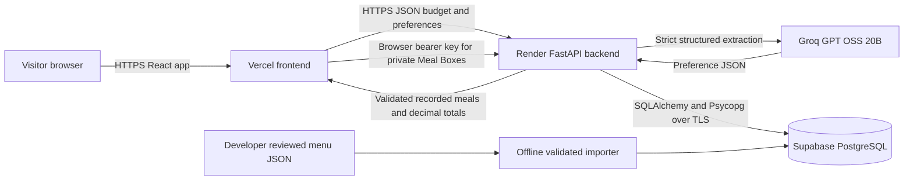

# Architecture

AnimoMeals is a visitor-facing budget recommender. It has no active administrator account or public menu-write endpoint. All database queries and Groq requests are owned by the FastAPI backend. The browser receives catalog data and validated suggestions; it never receives database or AI-provider credentials.

## Recommendation flow

1. The user enters a positive PHP budget and optional preference text.
2. The backend validates the request and reads affordable, listed catalog entries joined with their shops. With no matching entries it returns an honest empty result without contacting Groq.
3. Nonblank text is sent to Groq with the schema and extraction prompt in `backend/app/ai.py`. English, Tagalog, Hiligaynon and Bisaya are supported by the prompt, with conservative alias handling in the matcher.
4. The backend validates the returned structure and rejects conflicting budgets. It selects combinations from database entries, checks restrictions and computes totals using Decimal. Groq never supplies menu prices.
5. The visitor can save a suggestion, then edit its name, budget, meals and quantities. The backend authorizes ownership by a hash of the browser-held random key, resolves item references and validates totals before committing.

## Boundaries and choices

React handles display and interaction; FastAPI separates AI/data logic; PostgreSQL preserves records across free-host restarts. SQLAlchemy models and Alembic migrations provide reproducible schema changes. Small curated data avoids live-stock claims. Staging uses a restricted role/schema in the same Supabase project, not a second project or public staging host. See [staging](../STAGING.md), [schema](SCHEMA.md), [API](API.md) and [pipeline](../PIPELINE.md).

Current deployment evidence is a dated snapshot. Frontend release source `8e5cf398f04c38a94583b61e83190686c683db48`; backend `/api/environment` reported `e879f3fd35fdf2665881d377ef7ba803f5ebabea`. The backend source trees at those commits are identical because the later change touched only frontend artwork and documentation. Both are represented by release tag v1.1.0. Subsequent documentation-only commits may trigger a new hosting build.
