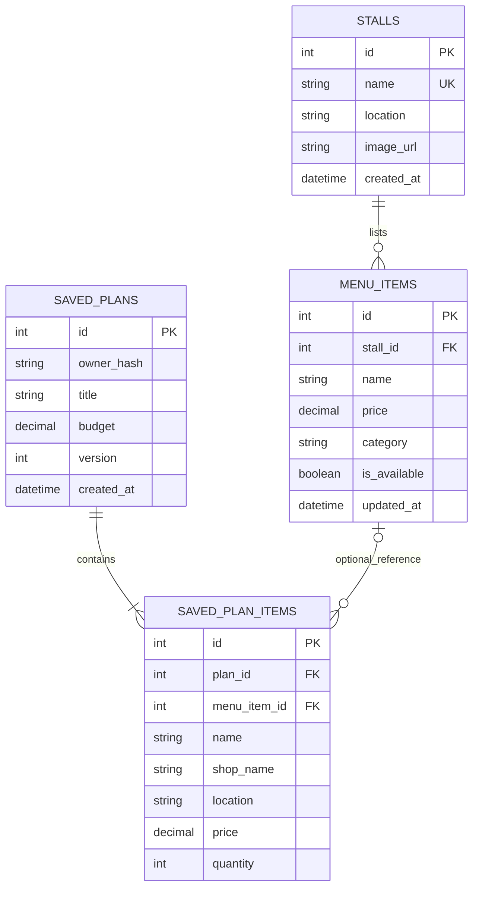

# Database schema

`stalls.id` links to `menu_items.stall_id`. `saved_plans.id` links to snapshot items through `saved_plan_items.plan_id` with delete cascade. Snapshot items optionally reference a menu record with ON DELETE SET NULL; saved names, shop details and unit prices remain readable after catalog changes. Totals are calculated from unit prices multiplied by quantities. These are recorded prices, not live quotes. The internal `is_available` field is exposed as `is_listed`; it is not live stock.

Migration revisions 0001 and 0002 establish the catalog and image fields; 0003 adds visitor boxes and PostgreSQL row-level security; 0004 adds quantities, optional menu references and edit versions. Existing boxes migrate to one portion per item. Quantity constraints allow integers 1-20. Models: [models.py](../backend/app/models.py). Migration history: [Alembic versions](../backend/alembic/versions). The production and restricted staging schemas were verified at 0004 on November 27, 2026.

The FastAPI backend applies ownership filters to every Meal Box operation. Raw bearer keys are never stored in database records. Anonymous browser clients have no direct public database-write route. Saved boxes persist until the holder deletes them; clearing local browser storage loses access rather than deleting the database records. There is no account recovery or automatic orphan-record cleanup. See [API limits and authorization](API.md).
